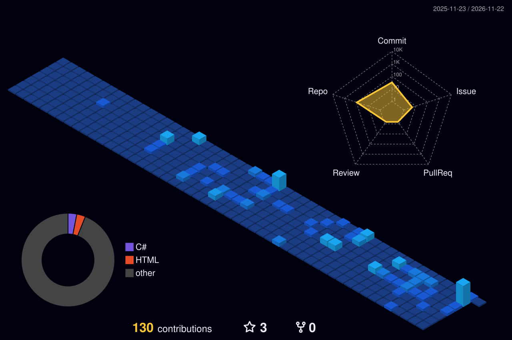

<div align="center">

# 👨‍💻 LÊ TUẤN THÀNH                                                                                               

**Java Backend Developer**  
*Học Java Backend | Spring Boot | PostgreSQL | Microservices | DevOps*

<br/>

[](https://github.com/Thanh-hub-company)
&nbsp;
[](mailto:24003852@caut.edu.vn)

<br/><br/>


<br/>

`#java` `#spring-boot` `#postgresql` `#jdbc` `#microservices` `#docker` `#kubernetes` `#ci-cd` `#rest-api` `#devops`

</div>

---


### ⚡ Bé Thú Cưng Cày Code: Pikachu (Git-Pet Tamagotchi)

<div align="center">

  <table>
    <tr>
      <td align="center" width="220">
        <!-- ẢNH ĐỘNG PIKACHU PIXEL-ART VẨY ĐUÔI CỰC CUTE -->
        
        <br/><br/>
        <b>⚡ Pikachu (Pika Cày Code)</b>
        <br/>
        <sub><i>"Pika-pika! Đợi Thành nạp commit để phóng điện 100,000 Volts!"</i></sub>
      </td>
      <td valign="middle">
        <p><b>⭐ Cấp độ (Level):</b> <code>Lv. 16</code> &nbsp;•&nbsp; <b>Hệ:</b> <code>Điện / Java Ecosystem ⚡</code></p>
        <p><b>❤️ Sức khỏe (HP):</b>  <code>[████████████████████] 100%</code> (Đang tràn đầy năng lượng ⚡)</p>
        <p><b>🍎 Đã ăn hôm nay:</b>  <code>[████████████████   ] 85%</code> (Vừa nhai xong commit Java ngon lành!)</p>
        <p><b>🔋 Pin năng lượng:</b> <code>[⚡⚡⚡⚡⚡⚡⚡⚡⚡ ] 90%</code> <i>(Sẵn sàng thức đêm cùng Thành fix bug)</i></p>
        <p><b>🐾 Tuyệt chiêu siêu đẳng:</b></p>
        <ul>
          <li>⚡ <b>100,000 Volt Spring Boot:</b> Phóng điện giật tan biến mọi lỗi Bug</li>
          <li>🐾 <b>Tốc độ ánh sáng PostgreSQL:</b> Tối ưu hóa Index chạy nhanh như chớp</li>
          <li>🛡️ <b>Đuôi Sắt Docker:</b> Đóng gói Container an toàn bất khả xâm phạm</li>
        </ul>
      </td>
    </tr>
  </table>

  <sub>💛 <i>Tiến hóa thành <b>Raichu</b> khi Thành làm chủ hoàn toàn Microservices & DevOps! Đừng để Pikachu đói nhé!</i></sub>

</div>

---

### 🐍 Hoạt Động Commit (Snake Game)

<div align="center">
  <picture>
    <source media="(prefers-color-scheme: dark)" srcset="https://raw.githubusercontent.com/Thanh-hub-company/Thanh-hub-company/output/github-contribution-grid-snake-dark.svg">
    <source media="(prefers-color-scheme: light)" srcset="https://raw.githubusercontent.com/Thanh-hub-company/Thanh-hub-company/output/github-contribution-grid-snake.svg">
    
  </picture>
</div>

<br/>

<!-- WIDGET PHÁT NHẠC LOFI SÓNG NHẢY CHILL -->
<div align="center">
  
</div>

---
### 🏙️ Không Gian Hoạt Động 3D (3D Isometric City)

<div align="center">
  
</div>

---

### 🎮 Thử Thách Trí Tuệ: Connect Four (Cờ 4 Nối Tiếp)

> **Luật chơi:** Bấm vào chữ **[Thả]** ở các cột bên dưới để thả quân cờ đỏ 🔴 của bạn. Máy tính sẽ đánh quân cờ vàng 🟡 đáp trả. Ai nối đủ 4 viên thẳng hàng (ngang, dọc, chéo) trước là người chiến thắng!

<!-- connect-four-start -->
<!-- connect-four-header-start -->
| Cột 1 | Cột 2 | Cột 3 | Cột 4 | Cột 5 | Cột 6 | Cột 7 |
| :---: | :---: | :---: | :---: | :---: | :---: | :---: |
| [Thả](https://github.com/Thanh-hub-company/Thanh-hub-company/issues/new?title=connect-four%7Cdrop%7C1&body=Just+click+'Submit+new+issue'+to+drop+a+disc!) | [Thả](https://github.com/Thanh-hub-company/Thanh-hub-company/issues/new?title=connect-four%7Cdrop%7C2&body=Just+click+'Submit+new+issue'+to+drop+a+disc!) | [Thả](https://github.com/Thanh-hub-company/Thanh-hub-company/issues/new?title=connect-four%7Cdrop%7C3&body=Just+click+'Submit+new+issue'+to+drop+a+disc!) | [Thả](https://github.com/Thanh-hub-company/Thanh-hub-company/issues/new?title=connect-four%7Cdrop%7C4&body=Just+click+'Submit+new+issue'+to+drop+a+disc!) | [Thả](https://github.com/Thanh-hub-company/Thanh-hub-company/issues/new?title=connect-four%7Cdrop%7C5&body=Just+click+'Submit+new+issue'+to+drop+a+disc!) | [Thả](https://github.com/Thanh-hub-company/Thanh-hub-company/issues/new?title=connect-four%7Cdrop%7C6&body=Just+click+'Submit+new+issue'+to+drop+a+disc!) | [Thả](https://github.com/Thanh-hub-company/Thanh-hub-company/issues/new?title=connect-four%7Cdrop%7C7&body=Just+click+'Submit+new+issue'+to+drop+a+disc!) |
<!-- connect-four-header-end -->
<!-- connect-four-board-start -->
| ⚪ | ⚪ | ⚪ | ⚪ | ⚪ | ⚪ | ⚪ |
| ⚪ | ⚪ | ⚪ | ⚪ | ⚪ | ⚪ | ⚪ |
| ⚪ | ⚪ | ⚪ | ⚪ | ⚪ | ⚪ | ⚪ |
| ⚪ | ⚪ | ⚪ | ⚪ | ⚪ | ⚪ | ⚪ |
| ⚪ | ⚪ | ⚪ | ⚪ | ⚪ | ⚪ | ⚪ |
| ⚪ | ⚪ | ⚪ | ⚪ | ⚪ | ⚪ | ⚪ |
<!-- connect-four-board-end -->
<!-- connect-four-end -->


### 📊 Tỷ Lệ Ngôn Ngữ (Languages Breakdown)

| Ngôn ngữ | Tỷ lệ | Phân bổ trực quan |
| :--- | :---: | :--- |
| **Java**       | 62% | `██████████████████████████████                          ` |
| **SQL**        | 14% | `███████                                                 ` |
| **YAML**       | 12% | `██████                                                  ` |
| **Dockerfile** | 7%  | `███                                                     ` |
| **Shell**      | 5%  | `██                                                      ` |

---

### 🎯 Lộ Trình Học Tập (Learning Roadmap)

- [x] **1. JDBC Foundation (100%)** — *CRUD thuần, Connection pool HikariCP, quản lý Transaction*
- [x] **2. Spring REST API (85%)** — *Spring Data JPA, Bean Validation, DTO Pattern, tài liệu OpenAPI*
- [ ] **3. Microservices (65%)** — *Eureka Discovery, Spring Cloud Gateway, Docker Compose đa dịch vụ*
- [ ] **4. DevOps & Cloud (50%)** — *CI/CD GitHub Actions, Dockerfile tối ưu, K8s Manifests, Helm*

---

### 📂 Danh Sách Repositories Tiêu Biểu

| Repository | Mô tả tóm tắt | Công nghệ |
| :--- | :--- | :--- |
| 📦 [**microservices-ecommerce**](#-dự-án-tiêu-biểu-microservices-ecommerce) | Hệ thống phân tán gồm user, order, product, gateway, eureka | `Java` `YAML` |
| 📦 [**spring-boot-rest-api**](https://github.com/Thanh-hub-company) | REST API quản lý sản phẩm, JPA, Validation, Swagger | `Java` |
| 📦 [**jdbc-postgres-playground**](https://github.com/Thanh-hub-company) | CRUD thuần JDBC, quản lý connection pool HikariCP | `Java` `SQL` |
| 📦 [**devops-ci-cd-pipeline**](https://github.com/Thanh-hub-company) | GitHub Actions tự động build, test và deploy lên VPS | `YAML` `Docker` `Shell` |
| 📦 [**k8s-microservices-deploy**](https://github.com/Thanh-hub-company) | Kubernetes manifests, Ingress Controller và Helm chart | `YAML` |
| 📦 [**postgres-sql-practice**](https://github.com/Thanh-hub-company) | Bài tập query, đánh index, transaction, EXPLAIN ANALYZE | `SQL` |

---

### 🌟 Dự Án Tiêu Biểu: `microservices-ecommerce`


#### 1. Cấu trúc thư mục (File Tree)

```text
microservices-ecommerce/
├── api-gateway/                   # Spring Cloud Gateway (Port 8080)
├── user-service/                  # Quản lý người dùng & JWT Auth (Port 8081)
├── product-service/               # Danh mục sản phẩm & tồn kho (Port 8082)
├── order-service/                 # Xử lý đơn hàng & checkout (Port 8083)
├── .github/workflows/ci.yml       # CI pipeline: test, build, push Docker
├── docker-compose.yml             # Khởi chạy toàn bộ hệ sinh thái & PostgreSQL
├── pom.xml                        # Maven Parent POM
└── README.md
```

#### 2. Sơ đồ kiến trúc (Architecture)

```text
                       [ Client Request ]
                               │
                               ▼
                    ┌─────────────────────┐
                    │ API Gateway (:8080) │
                    └──────────┬──────────┘
                               │
             ┌─────────────────┼─────────────────┐
             ▼                 ▼                 ▼
     ┌──────────────┐  ┌──────────────┐  ┌──────────────┐
     │ User Service │  │Product Serv. │  │ Order Service│
     │   (:8081)    │  │   (:8082)    │  │   (:8083)    │
     └──────┬───────┘  └──────┬───────┘  └──────┬───────┘
            │                 │                 │
            ▼                 ▼                 ▼
     [ PostgreSQL ]    [ PostgreSQL ]    [ PostgreSQL ]
```

#### 3. Hướng dẫn khởi chạy nhanh

```bash
# 1. Đóng gói mã nguồn
./mvnw clean package -DskipTests

# 2. Khởi chạy toàn bộ cụm dịch vụ qua Docker Compose
docker compose up -d --build

# 3. Kiểm tra trạng thái các container
docker compose ps
```

#### 4. Danh sách API Endpoints chính qua Gateway (:8080)

| Method | Endpoint | Service phụ trách | Quyền |
| :--- | :--- | :--- | :---: |
| `POST` | `/api/v1/auth/login` | `user-service` | Public |
| `GET` | `/api/v1/products` | `product-service` | Public |
| `POST` | `/api/v1/products` | `product-service` | Admin |
| `POST` | `/api/v1/orders` | `order-service` | User |
| `GET` | `/api/v1/orders/{id}` | `order-service` | User |

---

### ✦ Nhật Ký Hoạt Động (Recent Activity)

- 🚀 **Released** `v1.1.0` of `microservices-ecommerce`
- 🔀 **Opened PR #12**: `Add Dockerfile and docker-compose for product-service`
- 📦 **Pushed 3 commits** to `order-service`: `feat: add order status workflow`
- ⭐ **Starred** `spring-projects/spring-boot`

---

<div align="center">
  <sub>© 2026 Lê Tuấn Thành • Học tập & Xây dựng hệ thống Java Backend hiệu năng cao</sub>
</div>
